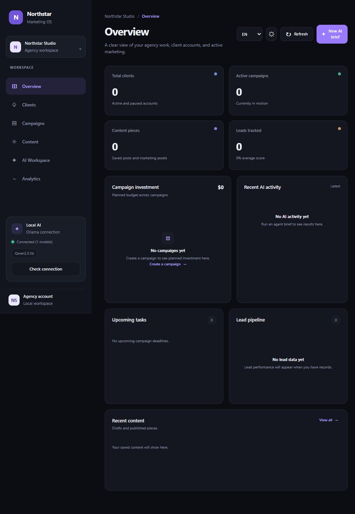
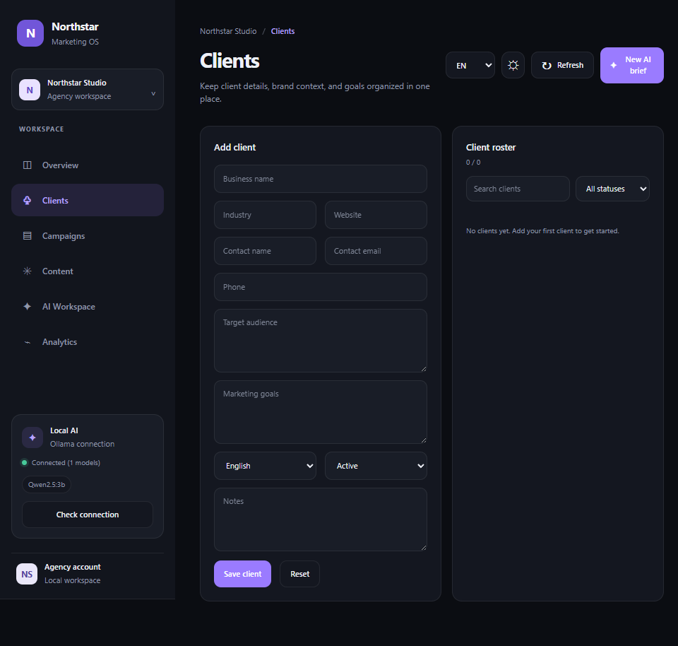
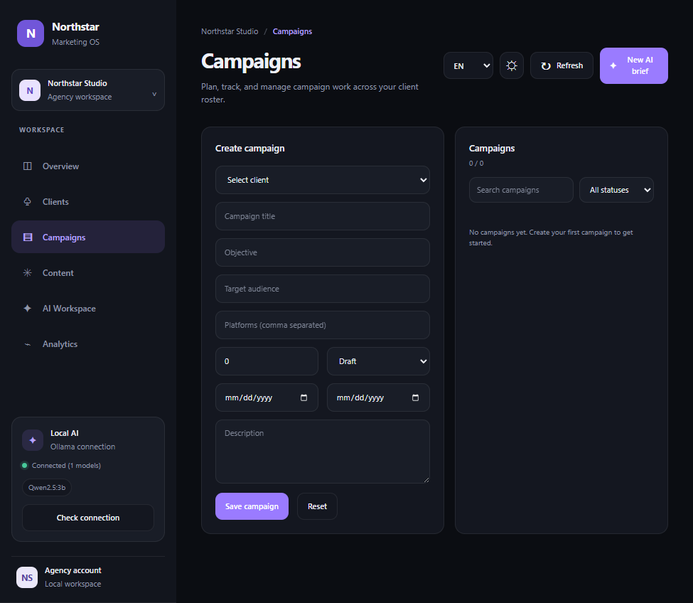
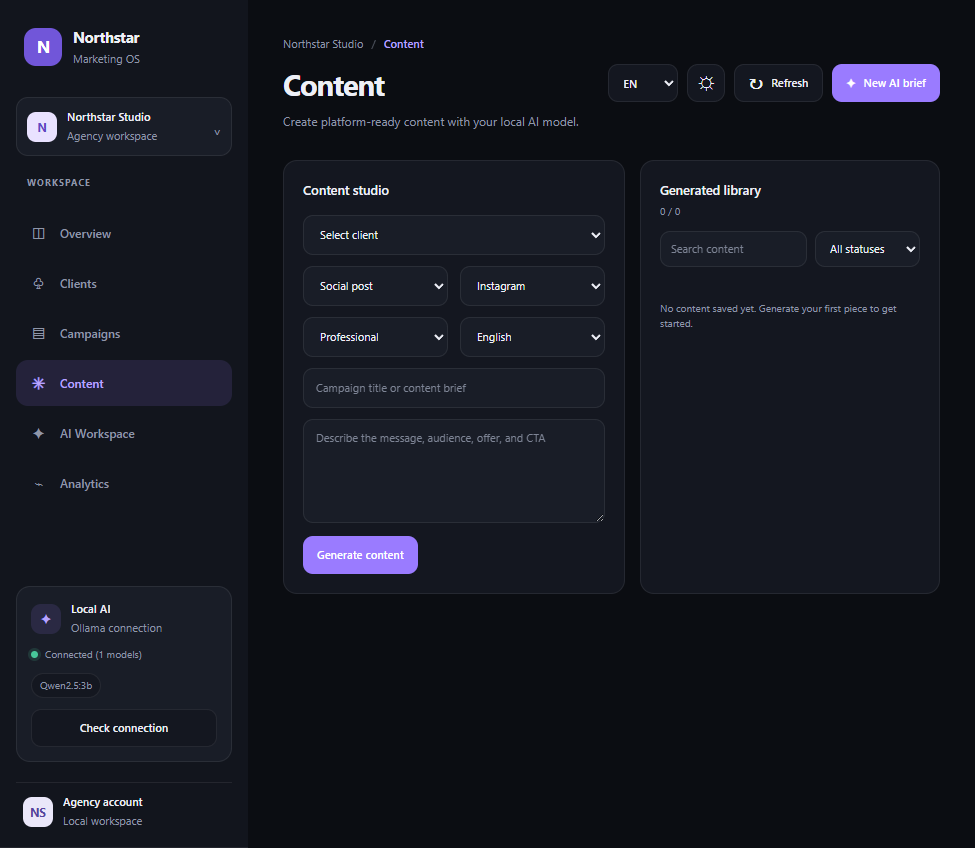
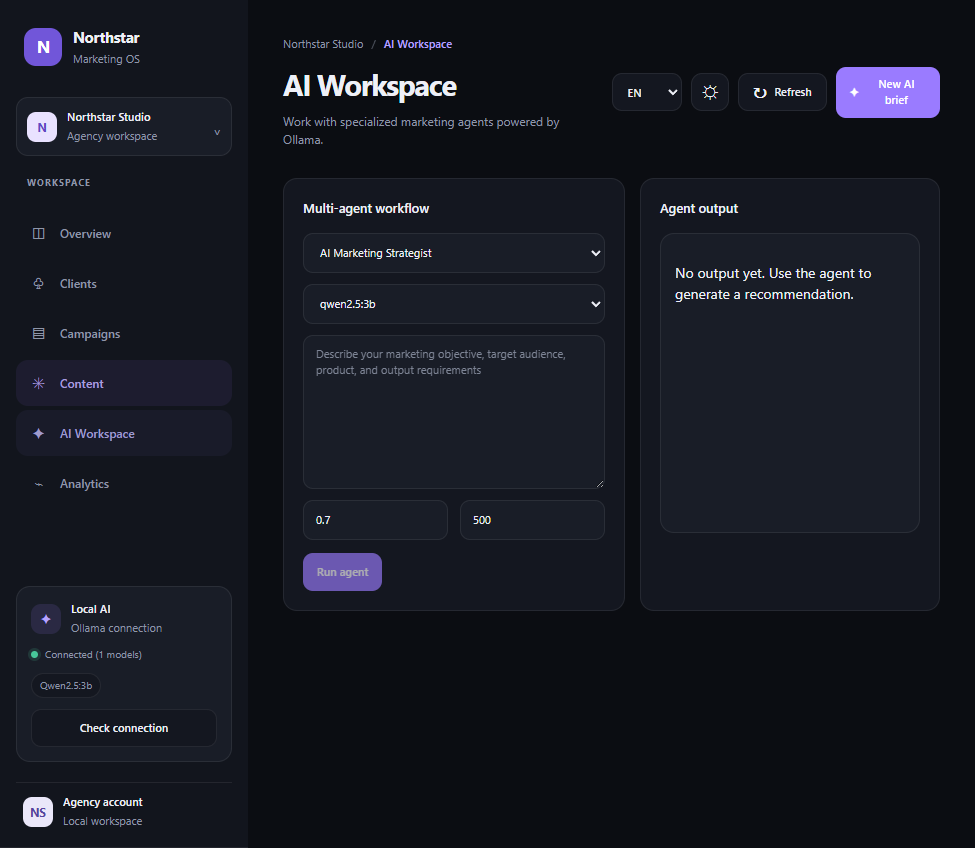
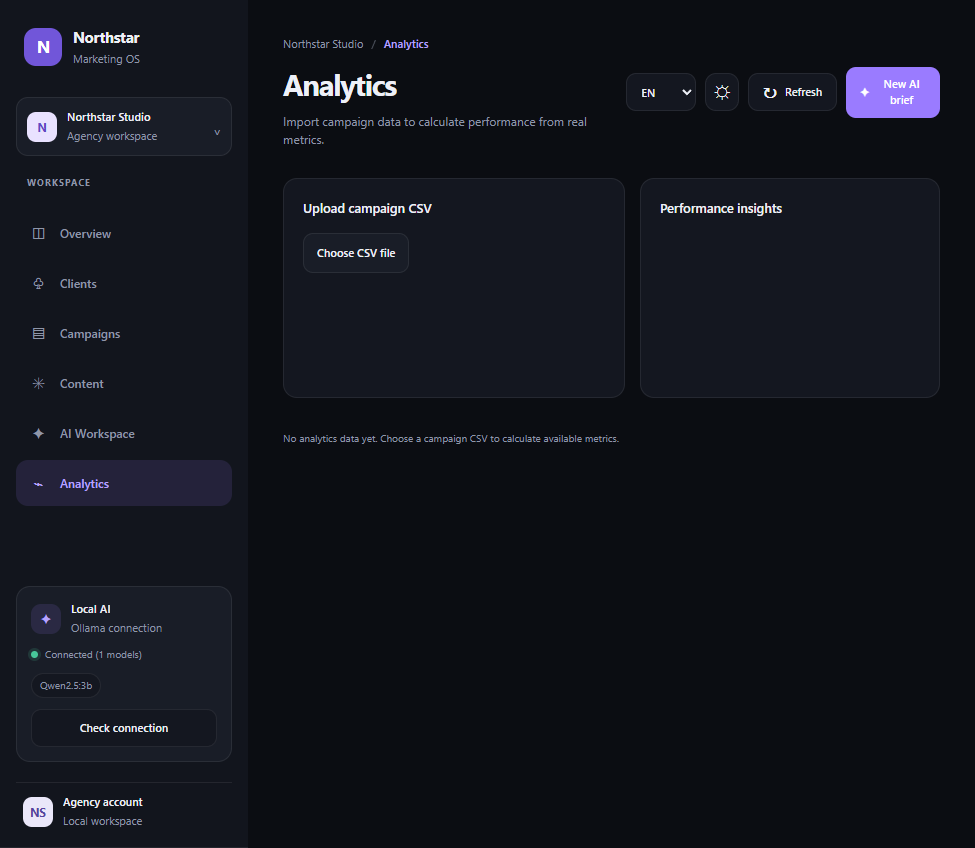

# Northstar Marketing OS

A local-first marketing agency workspace built with React, Express, SQLite, and Ollama.

## Screenshots

| Overview | Clients |
| --- | --- |
|  |  |

| Campaigns | Content |
| --- | --- |
|  |  |

| AI Workspace | Analytics |
| --- | --- |
|  |  |

## Run locally

Requirements: Node.js 20.19+ and a running Ollama server with at least one model installed.

1. Copy `.env.example` to `.env` and set `OLLAMA_BASE_URL` and `OLLAMA_MODEL`.
2. Install dependencies with `npm install`.
3. Start the backend and Vite frontend with `npm run dev`.
4. Open the Vite URL shown in the terminal (normally `http://localhost:5173`).

The SQLite database is stored in `data/agency.db`. New installations start empty; dashboard metrics are calculated from stored records and imported CSV data.

## Commands

- `npm run dev` — start the local API and frontend with hot reload.
- `npm run build` — create the production frontend bundle in `dist/`.
- `npm run build:watch` — rebuild the production bundle when source files change.
- `npm start` — serve the production bundle and API.
- `npm run preview` — preview the frontend bundle without the API.

## Configuration

See `.env.example` for the supported settings. The API binds to `127.0.0.1` by default so local client and lead data is not exposed to the network. Set `HOST` only when deploying behind an appropriately secured reverse proxy.

The application does not publish to social networks or connect to external analytics platforms. Campaign/content statuses and imported analytics are local records only.

## Production deployment notes

This is a single-workspace local-first application, not a hosted multi-tenant service. Before exposing it to a network or using it with confidential client records, add user authentication and authorization, organization-level data isolation, HTTPS via a reverse proxy, backup/restore procedures, and an operational logging/monitoring policy. Keep `.env` and `data/agency.db` private and backed up.
